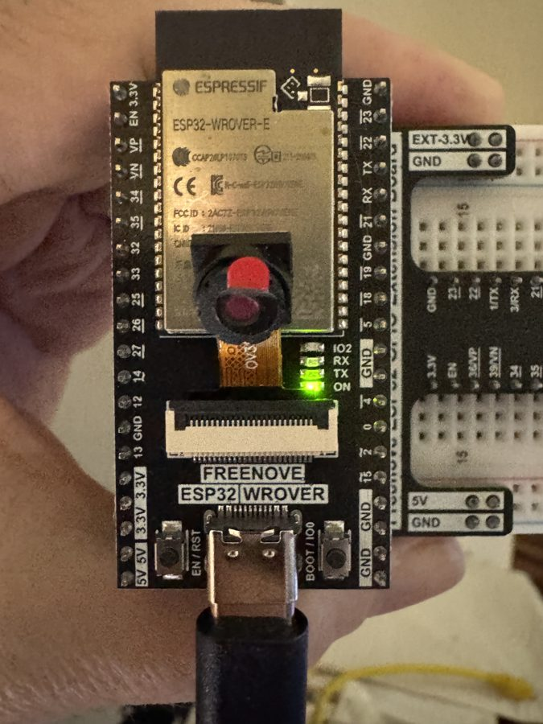
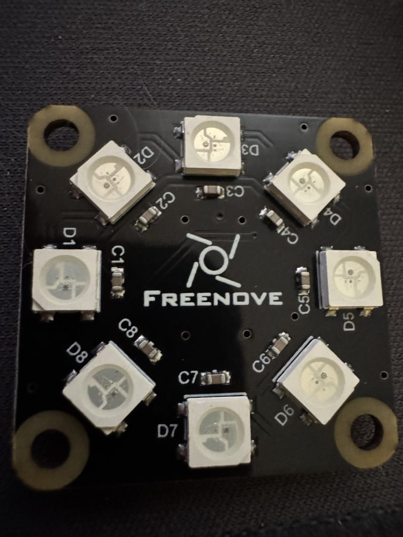
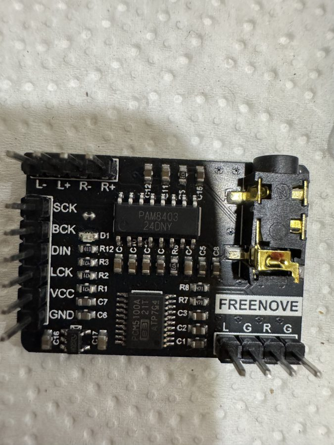

# mcp-esp32

A **WebAssembly-based [Model Context Protocol](https://modelcontextprotocol.io) (MCP) server for microcontrollers**. It lets an LLM (Claude, ChatGPT, etc.) control a physical device directly — and *what* it can control is defined entirely by the WASM modules you load.

So far it has been built and tested on the **ESP32 (ESP32-WROVER-E with PSRAM)**.

## The idea

The firmware is a generic host: WiFi, an HTTP server that speaks MCP (JSON-RPC 2.0), and a WebAssembly runtime ([WAMR](https://github.com/bytecodealliance/wasm-micro-runtime)). It knows nothing about LEDs, speakers, or sensors.

The device's capabilities come from **WASM modules** loaded from the SD card. Each module registers MCP *tools* (name, description, handler). When an LLM calls `tools/list` it sees those tools; when it calls `tools/call`, the request is dispatched into the module, which talks to hardware through a small set of host functions (GPIO, PWM, Bluetooth audio, logging, ...).

Want the LLM to be able to do something new? Write a few C functions, compile to `.was`, drop it on the SD card, and map it to a route. No firmware reflash needed for new tool logic.

```
LLM client
   │  HTTP POST /mcp/...   (MCP / JSON-RPC 2.0)
   ▼
ESP32 firmware ── HTTP server ── route → WASM module (from SD card)
                                          │  tools/list, tools/call
                                          ▼
                                   WAMR runtime (sandboxed)
                                          │  host functions
                                          ▼
                                   GPIO / PWM / Bluetooth / ...
```

### Why WASM?

- **Sandboxed** — modules can only touch hardware through the host functions you expose, and protected GPIO pins are blocked by the host.
- **Swappable** — change device behavior by replacing a file, not reflashing firmware.
- **Portable** — the module/SDK side has no ESP32-specific code; the same approach should carry to other MCUs that can run WAMR.

## Demo

The proof of concept has been validated end to end on real hardware: an LLM connected over MCP discovers the device's tools, then blinks LEDs and **composes music on its own and plays it through a Bluetooth speaker** — all driven by WASM modules loaded from the SD card.

<table>
  <tr>
    <td align="center"><br><sub>ESP32-WROVER-E (4MB PSRAM) running the MCP host + WAMR</sub></td>
    <td align="center"><br><sub>8-LED module driven through GPIO host functions</sub></td>
    <td align="center"><br><sub>I2S DAC + PAM8403 amp for local audio (Bluetooth A2DP also supported)</sub></td>
  </tr>
</table>

### LED control

The `led_controller` module exposes `control_led`, `toggle_led`, `get_led_status` and `get_system_info`. The LLM decides which pins to switch and when; the host refuses any pin listed as protected in `cfg.jsn`.

### LLM-generated music over Bluetooth

The `music_player` module exposes Bluetooth and playback tools. A typical session, entirely driven by the LLM:

1. `bluetooth_init` → `bluetooth_scan` — find nearby speakers
2. `bluetooth_connect` with the speaker's MAC address
3. `play_melody` with a melody the LLM writes itself, including chords:

```json
{"name": "play_melody",
 "arguments": {"melody": "C4:400,E4:400,G4:400,[C4,E4,G4]:800,A4:400,[F4,A4,C5]:800",
               "output": "bluetooth", "volume": 60}}
```

The WASM module parses the note string and calls host functions; the host synthesizes the audio and streams it to the speaker over A2DP. `stop_music` ends playback.

## What's in the repo

```
main/main.c                    Example app: WiFi + HTTP server + WASM runtime wiring
mcp_esp32_framework/
├── host/                      Reusable ESP-IDF host framework
│   ├── include/, src/         HTTP server, WASM runtime, host functions,
│                              config loader, pthread pool, sessions, Bluetooth audio
├── wasm_sdk/                  SDK for writing MCP tools in C (mcp_sdk.h / mcp_sdk.c)
├── examples/
│   ├── minimal/               hello / echo / add tools — start here
│   ├── led_controller/        GPIO LED control
│   └── music_player/          Melodies & chords over Bluetooth (A2DP) speaker
└── tools/                     WASM build scripts (WASI-SDK)
cfg.jsn                        Route → module mapping + GPIO protection (copy to SD card)
docs/                          Architecture notes and plans
```

## Writing a tool

A module registers tools at startup and handles calls with plain C:

```c
#include "mcp_sdk.h"

mcp_result_t add_handler(const char* params) {
    int32_t a = 0, b = 0;
    if (mcp_parse_int_param(params, "a", &a) != 0) return mcp_error(-1, "Missing 'a'");
    if (mcp_parse_int_param(params, "b", &b) != 0) return mcp_error(-1, "Missing 'b'");

    char out[64];
    snprintf(out, sizeof(out), "%d + %d = %d", a, b, a + b);
    return mcp_success(out);
}

void _start() {
    mcp_server_init("my_module", "1.0.0");
    // register tools (name, description, handler) — see examples/minimal
}
```

Host functions currently exposed to modules include `gpio_set_level`, `gpio_get_level`, `gpio_set_direction`, `gpio_is_pin_protected`, `pwm_*`, SSE event helpers, JSON helpers, and Bluetooth audio playback.

## Getting started

### Requirements

- ESP32 with PSRAM (tested on **ESP32-WROVER-E**; plain ESP32 doesn't have enough RAM for WAMR + MCP)
- SD card (FAT32) for modules and config
- [ESP-IDF v5.5](https://docs.espressif.com/projects/esp-idf/)
- [WASI-SDK](https://github.com/WebAssembly/wasi-sdk/releases) (20.0) for compiling modules
- WAMR checked out alongside this repo

### 1. Build a WASM module

```bash
cd mcp_esp32_framework/examples/minimal
./build.sh            # produces wasm/*.was
```

### 2. Prepare the SD card

```
/sdcard/cfg.jsn        # routes + GPIO protection
/sdcard/wasm/*.was     # your modules
```

`cfg.jsn` maps HTTP routes to modules:

```json
{
  "gpio_protection": {
    "protected_pins": [0, 1, 6, 7, 8, 9, 10, 11],
    "input_only_pins": [34, 35, 36, 39],
    "max_current_pins": [12, 13]
  },
  "routes": {
    "/mcp":       "default.was",
    "/mcp/led":   "led_ctrl.was",
    "/mcp/music": "music_p.was"
  }
}
```

### 3. Build and flash the firmware

Copy `.env.example` to `.env` (gitignored) and set `WIFI_SSID` / `WIFI_PASS`, then:

```bash
cp .env.example .env   # then edit
. $HOME/esp/v5.5/esp-idf/export.sh
idf.py build flash monitor
```

The device's IP is printed in the serial log.

### 4. Talk to it

```bash
curl -X POST http://<esp32-ip>/mcp/led \
  -H "Content-Type: application/json" \
  -d '{"jsonrpc":"2.0","method":"tools/list","id":1}'

curl -X POST http://<esp32-ip>/mcp/led \
  -H "Content-Type: application/json" \
  -d '{"jsonrpc":"2.0","method":"tools/call","params":{"name":"control_led","arguments":{"pin":5,"state":1}},"id":2}'
```

Or point any MCP client that supports HTTP transport at the route.

Supported MCP methods: `initialize`, `initialized`, `tools/list`, `tools/call`, `ping`.

## Status

Working on ESP32-WROVER-E:

- MCP over HTTP with per-route WASM modules loaded from SD
- GPIO/LED control with pin protection
- Bluetooth A2DP speaker output — melodies and chords driven from WASM

In progress: refactoring `mcp_esp32_framework` into a clean drop-in ESP-IDF component, reducing audio popping, and testing on other boards.

## Troubleshooting notes

Hard-won lessons about WAMR on ESP32 (PSRAM setup, string handling, host function signatures, auxiliary stack size) are documented in:

- [wamr-troubleshooting-guide.md](wamr-troubleshooting-guide.md)
- [wamr-esp32-string-handling.md](wamr-esp32-string-handling.md)
- [docs/mcp_architecture.md](docs/mcp_architecture.md)

## Security

This is a hobby/research project. The HTTP endpoints have **no authentication** — anyone on your network can call the tools. Don't expose it to untrusted networks without adding auth.
